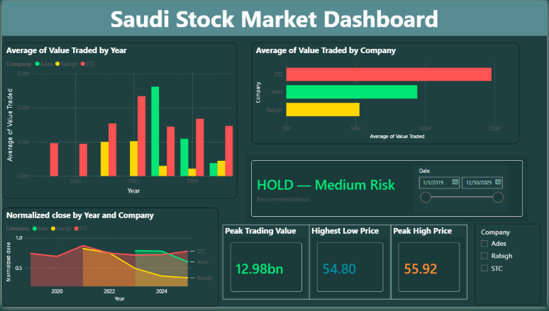
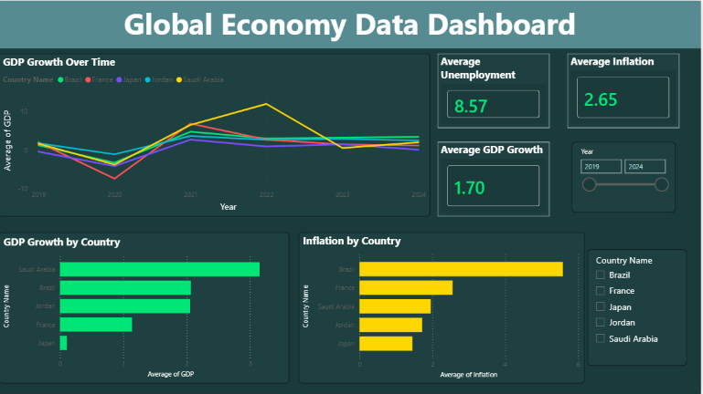
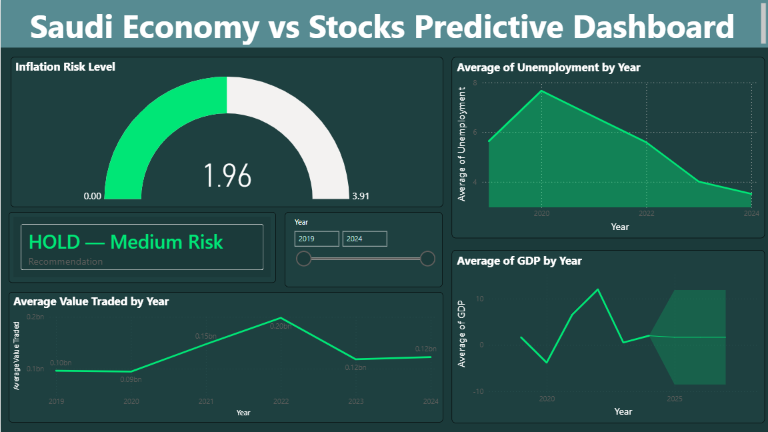
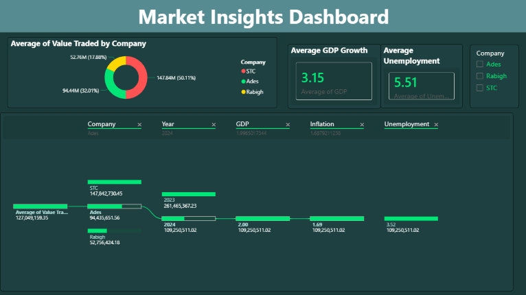

# Stocks & Economic Indicators Dashboard

An interactive, multi-page **Power BI** dashboard that integrates Saudi stock market data with macroeconomic indicators, combining descriptive, predictive, and prescriptive analytics to help users explore the relationship between financial markets and economic conditions.

> Course project — DS322: Business Intelligence, 2nd Semester 2025–2026.
> Aligned with **UN SDG 8** (Decent Work and Economic Growth) and **SDG 9** (Industry, Innovation and Infrastructure).

##  Problem Statement

Financial markets and economic conditions are closely linked, but investors and analysts often lack a unified tool to analyze both together. Do rising inflation rates negatively affect stock prices? Does strong GDP growth lead to better market performance? This dashboard was built to make these relationships explorable rather than theoretical.

##  Data Sources

| Dataset | Source | Records | Date Range |
|---|---|---|---|
| Daily stock prices and trading values | Saudi Exchange (Tadawul) | 2,360 trading days | 2019–2025 |
| GDP growth, inflation, and unemployment | World Bank Open Data | 125 rows per indicator | 2000–2024 |

- **Companies covered:** STC (2019–2025), Rabigh Refining & Petrochemical (2021–2025), and Ades (2023–2025)
- **Countries covered:** Saudi Arabia, Brazil, France, Japan, Jordan

Daily stock data and yearly economic data are linked through a shared `Year` field in the data model (`CompanyFact`, `DataGDP`, `Data Inflation`, `Data Unemployment` tables). Because each economic table holds five countries, the pages that compare stocks with the economy are filtered to **Saudi Arabia**, so Saudi stocks are compared with the Saudi economy only.

##  Dashboard Preview

**Saudi Stock Market Dashboard**

**Global Economy Data Dashboard**

**Saudi Economy vs Stocks Predictive Dashboard**

**Market Insights Dashboard**

##  Dashboard Pages

**1. Saudi Stock Market Dashboard** — KPI cards (Peak Trading Value, Highest Low Price, Peak High Price), a DAX-driven **Recommendation** card, average value traded by year and by company, and normalized closing price trends for the three companies.

**2. Global Economy Data Dashboard** — KPI cards for average GDP growth, unemployment, and inflation; GDP growth over time for all five countries; and side by side comparisons of average GDP growth and average inflation by country.

**3. Saudi Economy vs Stocks Predictive Dashboard** — An inflation risk gauge, Saudi unemployment and GDP growth trends, a **3-year GDP growth forecast**, average value traded by year, and the Recommendation card, covering the years where both stock and economic data are available (2019–2024).

**4. Market Insights Dashboard** — A donut chart of trading share by company, Saudi GDP growth and unemployment KPI cards, and a **decomposition tree** that breaks trading activity down by company, year, GDP growth, inflation, and unemployment for interactive root cause exploration.

All pages include slicers (date range, company, country, year) for interactive filtering.

##  Key DAX Measures

- **Recommendation** — a `SWITCH`-based measure that classifies average value traded into three activity tiers (above 1bn, above 100M, below 100M SAR) and labels them `SELL — High Risk`, `HOLD — Medium Risk`, or `BUY — Low Risk` (prescriptive analytics).
- **Normalized Close / Normalized Value Traded** — divides each company's average by its own maximum, so companies with very different price levels can be compared on one 0 to 1 scale.
- **Peak Trading Value, Highest Low Price, Peak High Price** — KPI measures for the Stocks page.
- **Average GDP Growth, Unemployment, Inflation** — `AVERAGE()`-based KPI measures used across the economy pages.

##  Tech Stack

- Microsoft Power BI (Power Query, Data Model relationships, DAX)
- Built-in Power BI forecasting for predictive trend lines

##  Limitations & Future Work

- Economic data is yearly while stock data is daily, so comparisons are necessarily approximate (linked via the `Year` field).
- Only 3 companies are covered, with different start dates, which may not represent the broader Saudi market.
- The Recommendation is a simple rule based on trading activity, built to demonstrate prescriptive analytics in DAX; it is not investment advice.
- External factors such as oil prices, interest rates, and global events are not included.
- No real-time/live data streaming — the model uses historical data up to 2025.

Planned improvements: connecting to live data via APIs (e.g. Yahoo Finance, Alpha Vantage), using quarterly instead of yearly economic data, adding risk measures such as price volatility to the recommendation logic, applying ML-based forecasting models, and adding sentiment analysis from financial news.

##  License

This project is shared for educational and portfolio purposes.
